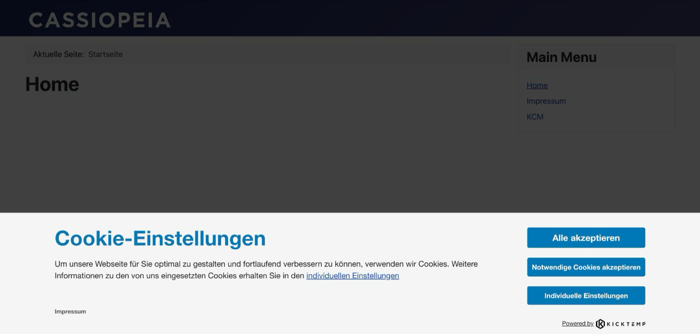
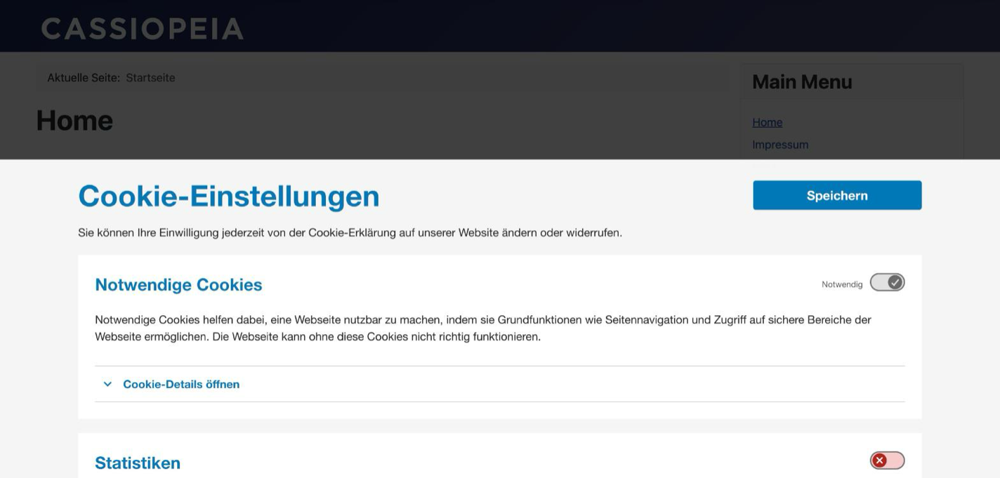
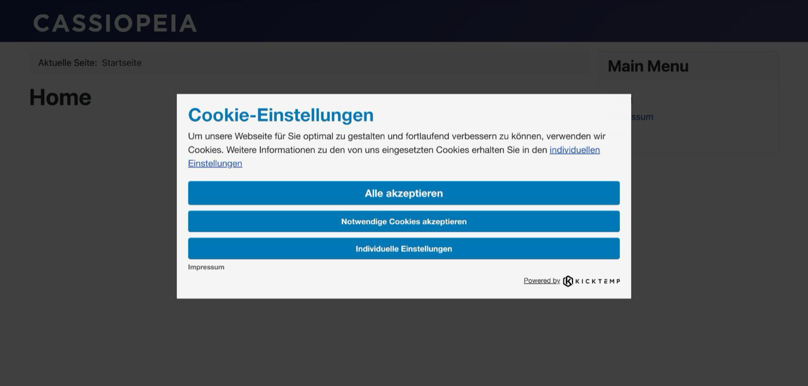
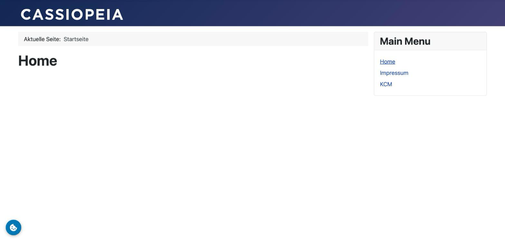
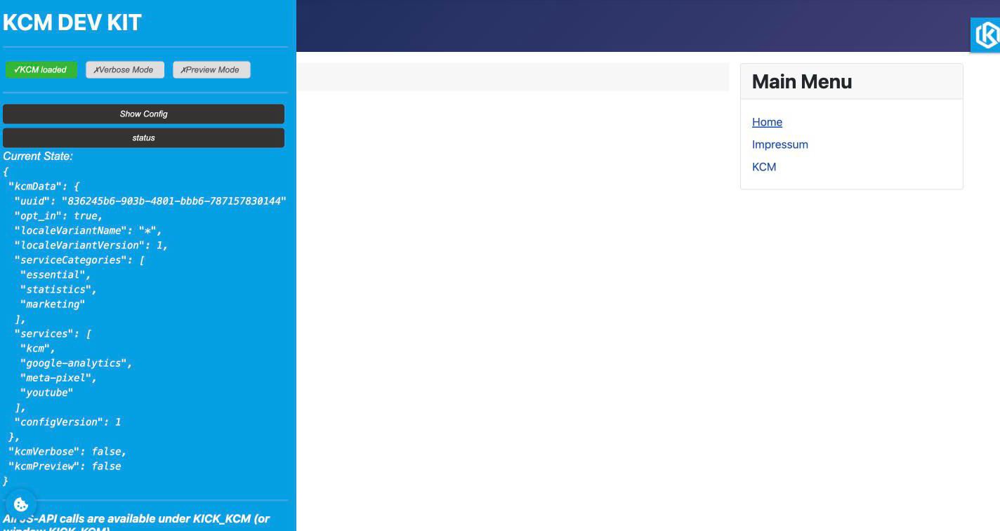

# Frontend

Der KCM zeigt beim ersten Besuch einer Website ein **Cookie-Banner** an. Abhängig von der Konfiguration gibt es zwei Layouts: das klassische **Banner** und die **Cookie-Wall**.

---

## Banner (Standard-Layout)

Das Banner erscheint als Overlay und zeigt dem Besucher zunächst eine kompakte Ansicht mit:

- Einem Einleitungstext (konfigurierbar)
- Dem Link zu den Datenschutzinformationen
- Dem Button **„Alle akzeptieren"**
- Dem Button **„Notwendige Cookies akzeptieren"**
- Optional: Dem Button **„Individuelle Einstellungen"**



---

## Cookie-Preference-Center (Erweiterte Ansicht)

Klickt der Nutzer auf „Individuelle Einstellungen", öffnet sich das **Cookie-Preference-Center (CPC)**. Hier kann der Nutzer pro Kategorie oder pro Service entscheiden:



Das CPC zeigt:
- Alle veröffentlichten **Service-Kategorien** mit ihrem Notwendig-Status
- Innerhalb jeder Kategorie alle zugehörigen **Services** mit Beschreibung und Informationsfeldern
- Aufklappbare **Cookie-Details** pro Service
- Toggle-Switches für jede Kategorie/jeden Service
- Den Button **„Speichern"** zum Übernehmen der Auswahl
- Den Button **„Einstellungen schließen"** zum Zurückkehren ohne Änderung

---

## Cookie-Wall (Wall-Layout)

Beim Wall-Layout überdeckt das Banner den gesamten Seiteninhalt. Der Besucher kommt erst an den Inhalt, nachdem er eine Entscheidung getroffen hat.



Das Wall-Layout aktivieren Sie in den Einstellungen unter **Tab Design → Layout → Wall**.

::: warning Rechtliche Anforderungen
Eine Cookie-Wall, die den Zugang zur Website vollständig sperrt, ist in bestimmten EU-Ländern und nach Auslegung der DSGVO rechtlich umstritten. Holen Sie rechtlichen Rat ein, bevor Sie das Wall-Layout einsetzen.
:::

---

## Ablauf einer Einwilligung

```
1. Besucher öffnet Seite erstmals
        ↓
2. KCM prüft: Existiert ein gültiger kcm_data-Cookie?
   Nein → Banner anzeigen
   Ja  → Scripts der eingewilligten Services laden
        ↓
3. Besucher trifft Entscheidung (Alle / Notwendige / Individuell)
        ↓
4. KCM speichert Einwilligung:
   - im Browser-Cookie kcm_data (Laufzeit: konfigurierbar)
   - in der Datenbank (Consent-Protokoll mit UUID)
        ↓
5. Zugestimmte Scripts werden sofort geladen
        ↓
6. Bei erneutem Besuch: kcm_data-Cookie vorhanden → kein Banner
```

---

## Einwilligung ändern oder widerrufen

Besucher können ihre Einwilligung jederzeit ändern. Dafür gibt es mehrere Wege, die sich kombinieren lassen.

### Button zum erneuten Öffnen (empfohlen)

Nach der Entscheidung blendet der KCM auf Wunsch einen kleinen runden **Cookie-Button** am Fensterrand ein. Ein Klick öffnet das Preference Center mit den gespeicherten Einstellungen. Position, Farben, Größe und Abstand sind einstellbar, siehe [Konfiguration](./configuration#button-zum-erneuten-offnen). Die Option ist standardmäßig ausgeschaltet.



- Der Button ist ein echter `<button>` mit Beschriftung für Screenreader und per Tab erreichbar.
- **Escape** schließt ein auf diesem Weg geöffnetes Banner, ohne die gespeicherte Einwilligung zu ändern. (Im normalen Banner lehnt Escape alle optionalen Cookies ab.)
- Nach „Speichern“, „Alle akzeptieren“ oder Escape springt der Fokus auf den Button zurück.

### Eigener Link oder Button

Jedes Element mit dem Attribut `data-kcm-open` oder der Klasse `kcm-js-open` öffnet das Preference Center:

```html
<a href="#" data-kcm-open>Cookie-Einstellungen ändern</a>
<button type="button" class="kcm-js-open">Cookie-Einstellungen</button>
```

Das funktioniert auch bei Elementen, die erst nach dem Laden der Seite eingefügt werden. Für ein Footer-Menü legen Sie einen Menüpunkt vom Typ **URL** mit der Adresse `#` an und tragen bei **Link-CSS-Klasse** `kcm-js-open` ein.

### JavaScript

Eigener Code kann `window.KICK_KCM.showPreferenceCenter()` aufrufen. Alle Funktionen stehen in der [JavaScript-API](./javascript-api).

### Cookie-Erklärungsseite

Auch die [Cookie-Erklärungsseite](#cookie-erklarungsseite-optional) erlaubt es, die Auswahl zu ändern. Sie ist dafür aber nicht mehr nötig.

### Über den Browser

Durch Löschen aller Cookies im Browser wird der `kcm_data`-Cookie entfernt, und das Banner erscheint beim nächsten Besuch erneut.

---

## Barrierefreiheit

Der Banner ist für die Bedienung per Tastatur und mit Screenreadern ausgelegt. Geprüft wurden Tastatur und Accessibility-Eigenschaften im Browser, nicht aber mit einem Screenreader und nicht gegen eine formale Konformitätsprüfung (WCAG, BFSG).

| Bereich | Verhalten |
|---|---|
| Dialog | Banner und Einstellungen sind Dialoge (`role="dialog"`, `aria-modal`) mit Namen über die Überschrift |
| Fokus | Beim Öffnen springt der Fokus in den Dialog, nach dem Schließen zurück auf den Button zum erneuten Öffnen |
| Tab-Reihenfolge | Der Fokus bleibt im geöffneten Dialog (Tab und Shift+Tab laufen im Kreis), auch in der erweiterten Ansicht |
| Escape | Schließt den Dialog. Beim ersten Besuch gilt das als „Nur notwendige“, beim erneuten Öffnen bleibt die gespeicherte Auswahl |
| Schalter | Jeder Schalter ist per Tastatur erreichbar (Leertaste schaltet), hat den Namen seiner Kategorie bzw. seines Services und zeigt den Fokus |
| Aufklappbereiche | „Cookie-Details“, Services und Cookies sind Buttons mit `aria-expanded` und per Enter oder Leertaste bedienbar |
| Bewegung | Mit `prefers-reduced-motion` entfallen die Animationen der Schalter und des Buttons |

::: tip Farben
Die Standardfarben erfüllen die WCAG-Stufe AA: Text hat mindestens 4,5:1 Kontrast (Standard-Blau `#0077b3` mit weißem Text 4,9:1), Schalter und Rahmen mindestens 3:1. Das gilt für das Banner- und das Wall-Layout. Wenn Sie im Tab „Design“ eigene Farben setzen, müssen Sie den Kontrast selbst prüfen. Beim Update bleiben bereits gespeicherte Farben unverändert. Mit **Design auf Standard zurücksetzen** übernehmen Sie die neuen Standardwerte.
:::

Nicht abgedeckt: Der Hintergrund der Website ist bei geöffnetem Dialog nicht inaktiv gesetzt (`inert`). Die Tastatur bleibt im Dialog, das virtuelle Cursor-Verhalten mancher Screenreader kann ihn dennoch verlassen.

---

## KCM DevKit (Entwickler)

Das DevKit ist ein im Frontend einblendbares Debug-Panel, das in den Einstellungen aktiviert werden kann.



Es zeigt:
- Status aller konfigurierten Services (zugestimmt / abgelehnt)
- Inhalt des `kcm_data`-Cookies
- Konfigurationsversion
- Debug-Informationen

::: warning Nur für Entwicklung
Das DevKit immer in der Produktion deaktivieren.
:::

---

## Verhalten bei deaktivierten Cookies

Wenn der Browser des Nutzers Cookies vollständig deaktiviert hat, kann der KCM keine Einwilligung speichern. In diesem Fall zeigt der KCM die **Kein-Cookie-Meldung** an (Text konfigurierbar in Tab „Übersetzungen").

---

## Cookie-Erklärungsseite (optional)

Die Komponente bringt eine Frontend-Ansicht mit, die als eigene Seite alle Service-Kategorien, Services und Cookies samt Informationen auflistet. Besucher können dort ihre Auswahl auch speichern.

**Wofür die Seite gut ist**

- Sie hat eine **eigene, verlinkbare URL**. Das ist praktisch für die Datenschutzerklärung, das Impressum oder einen Link im Banner.
- Sie dient als **vollständige Cookie-Erklärung** für Besucher und Prüfer, unabhängig davon, ob das Banner gerade offen ist.

**Wofür sie nicht mehr nötig ist**

Um die Einwilligung zu ändern, brauchen Besucher die Seite nicht mehr. Dafür gibt es den [Button zum erneuten Öffnen](#button-zum-erneuten-offnen-empfohlen) oder einen eigenen Link. Wer keine eigene Erklärungsseite möchte, legt einfach keinen Menüpunkt an.

**Einrichten**

1. **Menüs → Menü wählen → Neuer Menüpunkt**.
2. Menüpunkt-Typ: **Kick Consent Manager → Services**.
3. Titel vergeben (z. B. „Cookie-Erklärung“) und speichern.
4. Optional im Tab „Links“ der Komponenten-Einstellungen mit diesem Menüpunkt verknüpfen, damit die Seite im Banner verlinkt ist.

Die Überschrift und der Einleitungstext der Seite kommen aus den Übersetzungen (CPC-Texte).

::: tip Auf dieser Seite ist das Overlay aus
Auf der Cookie-Erklärungsseite und auf Seiten, die im Banner verlinkt sind, schaltet der KCM das Overlay ab und zeigt statt der Cookie-Wall das normale Banner. So können Besucher den Text lesen, bevor sie sich entscheiden.
:::
