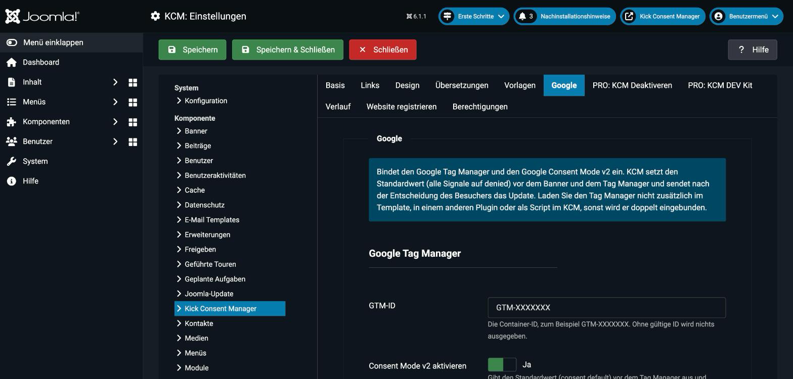
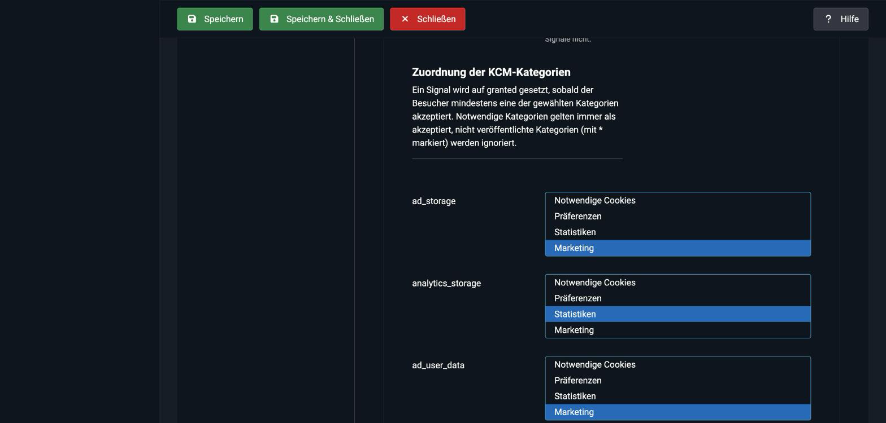

# Google Tag Manager & Consent Mode v2

Ab Version 1.5 kann der KCM den **Google Tag Manager (GTM)** einbinden und den **Google Consent Mode v2** steuern. Der KCM ist dabei die Consent-Management-Plattform (CMP): Er setzt die Standardwerte und meldet die Entscheidung des Besuchers an Google.

Die Einstellungen finden Sie in den Optionen im Tab **Google**.

---

## Advanced Mode

Der KCM arbeitet im **Advanced Mode** von Google:

1. Der Tag Manager lädt sofort, alle Signale stehen auf `denied`.
2. Google-Tags senden ohne Einwilligung nur cookielose Pings.
3. Nach der Entscheidung des Besuchers sendet der KCM ein `consent update`, und die Tags arbeiten entsprechend der Auswahl.

Einen Basic Mode (Tag Manager erst nach Einwilligung laden) gibt es nicht. Dafür legen Sie den Tag Manager als [Script](./scripts) in einer Kategorie an und lassen den Tab „Google“ leer.

---

## Ablauf im `<head>`

Die Reihenfolge ist wichtig und wird vom System-Plugin sichergestellt:

| Schritt | Inhalt |
|---|---|
| 1 | `dataLayer`, `gtag()` und `gtag('consent', 'default', …)` (plus `url_passthrough` und `ads_data_redaction`, falls aktiviert) |
| 2 | KCM-Konfiguration und `kcm.min.js` |
| 3 | Google Tag Manager (GTM-Loader) |

Beim Seitenaufruf mit gespeicherter Entscheidung sendet der KCM das `consent update` sofort, noch bevor der Tag Manager seine Tags auslöst. Nach jeder neuen Entscheidung und beim Widerruf (`triggerOptOut()`) folgt ein weiteres Update. Ändert sich der Stand nicht, sendet der KCM nichts doppelt.

Zusätzlich schreibt der KCM bei jedem Update das Event **`kcm_consent_update`** in den `dataLayer`, mit allen Signalen als Eigenschaften. Im Tag Manager können Sie darauf einen Trigger aufbauen. Die vorhandenen Events (`consents_initialized`, `consent_changed …`) bleiben unverändert.

---

## Einstellungen

| Feld | Standard | Bedeutung |
|---|---|---|
| **GTM-ID** | leer | Container-ID, zum Beispiel `GTM-XXXXXXX`. Ohne gültige ID wird nichts ausgegeben. |
| **Consent Mode v2 aktivieren** | Ja | Gibt den Standardwert aus und sendet Updates. |
| **GTM noscript-Iframe laden** | Nein | Gibt direkt hinter `<body>` den `<noscript>`-Iframe aus. Nur wählbar, wenn der Consent Mode aus ist, weil sich der Iframe sofort mit Google verbindet. |
| **URL-Passthrough** | Nein | `gtag('set', 'url_passthrough', true)` |
| **Ads Data Redaction** | Nein | `gtag('set', 'ads_data_redaction', true)` |
| **Wartezeit für das Consent-Update** | 500 ms | `wait_for_update`. Mit 0 wird der Wert nicht ausgegeben. |

### Standardwerte der Signale

Für jedes der sieben Signale legen Sie fest, ob es beim Seitenaufruf auf `granted`, `denied` oder gar nicht gesetzt wird.

| Signal | Standard |
|---|---|
| `ad_storage` | denied |
| `ad_user_data` | denied |
| `ad_personalization` | denied |
| `analytics_storage` | denied |
| `functionality_storage` | denied |
| `personalization_storage` | denied |
| `security_storage` | granted |

Mit **Benutzerdefinierte Standardwerte** ergänzen Sie weitere Signale (nur Kleinbuchstaben und Unterstriche). Der KCM aktualisiert diese Signale nicht, sie bleiben bei ihrem Standardwert.

### Zuordnung der KCM-Kategorien

Pro Signal wählen Sie die KCM-Kategorien, die es freigeben. Ein Signal steht auf `granted`, sobald der Besucher **mindestens eine** der gewählten Kategorien akzeptiert hat.

| Signal | Voreinstellung |
|---|---|
| `ad_storage`, `ad_user_data`, `ad_personalization` | marketing |
| `analytics_storage` | statistics |
| `functionality_storage`, `personalization_storage` | preferences |
| `security_storage` | essential |

Für die Zuordnung gelten diese Regeln:

- **Notwendige Kategorien** gelten immer als akzeptiert, auch bei „Nur notwendige“.
- **Nicht veröffentlichte Kategorien** sind in der Auswahl mit `*` markiert und werden ignoriert. Ist ein Signal nur mit unveröffentlichten Kategorien verknüpft, setzt der KCM es weder im Standardwert noch im Update.
- Haben Sie eigene Kategorien angelegt, ordnen Sie sie hier den passenden Signalen zu.

---

## Beispiele

| Entscheidung des Besuchers | Ergebnis |
|---|---|
| Noch keine | Nur der Standardwert, alles `denied` außer `security_storage` |
| Alle akzeptieren | Alle zugeordneten Signale `granted` |
| Nur notwendige | `security_storage: granted`, alle anderen `denied` |
| Nur Statistiken | `analytics_storage: granted`, Marketing-Signale `denied` |
| Widerruf über `triggerOptOut()` | Update auf `denied` |

---

## Hinweise

::: warning Den Tag Manager nur einmal einbinden
Laden Sie den Container nicht zusätzlich im Template, im Kick Tracking Assistant, in einem anderen Plugin oder als KCM-[Script](./scripts). Sonst läuft er doppelt, und die Consent-Signale stimmen nicht.
:::

::: tip Prüfen
Öffnen Sie den Tag Manager im **Vorschaumodus** (Tag Assistant). Dort sehen Sie unter „Consent“ den Standardwert beim Seitenstart und das Update nach der Entscheidung. In der Browser-Konsole zeigt `window.dataLayer` dieselbe Reihenfolge.
:::

Der KCM sorgt nur für die Signale. Ob und wie Google-Tags darauf reagieren, legen Sie im Tag Manager fest (Einwilligungseinstellungen der Tags).
