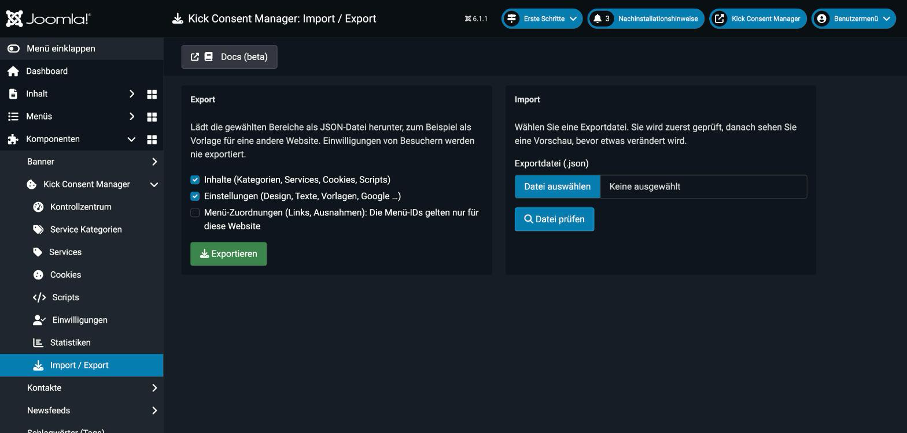
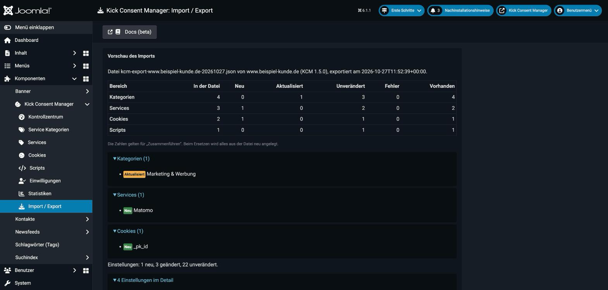
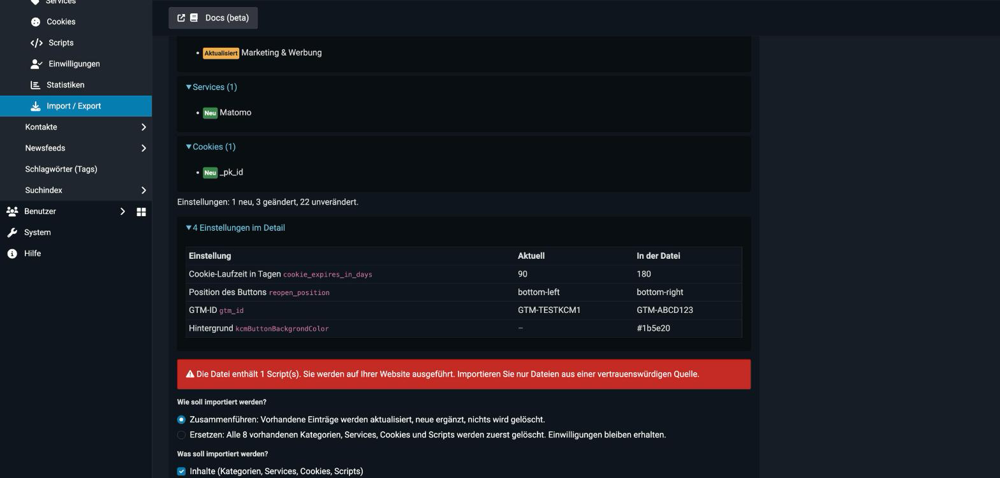

# Import / Export

Mit **Import / Export** übertragen Sie Ihre Konfiguration als JSON-Datei, zum Beispiel als Vorlage für Kundenwebsites oder von der Staging- auf die Live-Website. Die Ansicht erreichen Sie über das Menü der Komponente oder die Toolbar im Dashboard.

::: warning Nur für Super User
Die Ansicht ist nur mit dem Recht `core.admin` für die Komponente erreichbar. Importierte Scripts werden auf der Website ausgeführt.
:::

---

## Export

Wählen Sie die Bereiche und klicken Sie auf **Exportieren**. Der Browser lädt die Datei `kcm-export-<domain>-<datum>.json` herunter.

| Bereich | Inhalt |
|---|---|
| **Inhalte** | Kategorien, Services, Cookies und Scripts |
| **Einstellungen** | Alle Optionen der Komponente (Design, Texte, Vorlagen, Google …) |
| **Menü-Zuordnungen** | Links und Ausnahmen für Menüpunkte. Standardmäßig aus, weil die Menü-IDs nur für die jeweilige Website gelten. |

Nicht exportiert werden IDs, Zeitstempel, Autoren, Zugriffsrechte, die Konfigurationsversion, der Vorschau-Modus, das DevKit und vor allem **keine Einwilligungen** der Besucher.

---

## Import

Der Import läuft in zwei Schritten, damit nichts ungeprüft geändert wird.

### 1. Datei prüfen

Wählen Sie die Datei (`.json`, maximal 2 MB) und klicken Sie auf **Datei prüfen**. Der KCM prüft Format, Felder und Verweise. Die **Vorschau** zeigt pro Bereich, wie viele Einträge neu, aktualisiert, unverändert oder fehlerhaft sind, und wie viele Einstellungen sich ändern. Fehlerhafte Einträge werden aufgelistet und beim Import übersprungen.

Die Einstellungen listet der Block „Einstellungen im Detail“ mit dem aktuellen Wert und dem Wert aus der Datei auf.

### 2. Importieren

Wählen Sie den Modus und die Bereiche und klicken Sie auf **Jetzt importieren**.

| Modus | Wirkung |
|---|---|
| **Zusammenführen** | Vorhandene Einträge werden aktualisiert, neue ergänzt. Es wird nichts gelöscht. |
| **Ersetzen** | Alle vorhandenen Kategorien, Services, Cookies und Scripts werden zuerst gelöscht und dann aus der Datei neu angelegt. Einwilligungen bleiben erhalten. |

Der Import läuft in **einer Transaktion**. Tritt ein Fehler auf, wird alles zurückgenommen.

---

## Wie Einträge zugeordnet werden

| Typ | Schlüssel |
|---|---|
| Kategorie, Service | Alias |
| Cookie, Script | Alias des Services und Titel |

Services verweisen per Alias auf ihre Kategorie, Cookies und Scripts auf ihren Service. Ein Verweis muss in der Datei oder auf der Website vorhanden sein, sonst wird der Eintrag übersprungen. Beim **Ersetzen** erhalten die Einträge neue IDs.

Bei den Einstellungen werden nur bekannte Optionen der Komponente übernommen. Scripts aus einem Import sind für alle Besucher sichtbar (Zugriff „Public“).

---

## Tipps

- Legen Sie vor einem **Ersetzen** ein Backup der Datenbank an oder exportieren Sie zuerst die aktuelle Konfiguration.
- Erhöhen Sie nach einem Import die **Konfigurationsversion**, wenn sich Kategorien oder Services geändert haben. Besucher bestätigen dann ihre Auswahl erneut.
- Prüfen Sie nach dem Import Scripts und Google-Einstellungen (GTM-ID) auf der Zielwebsite.
