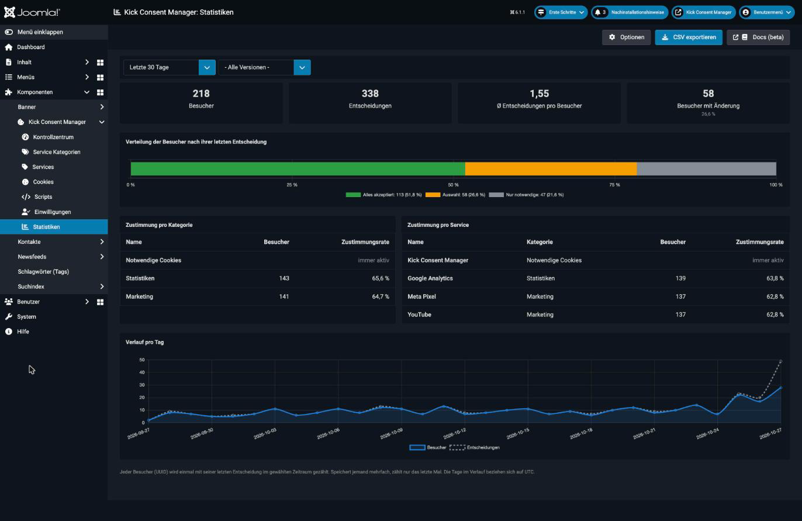
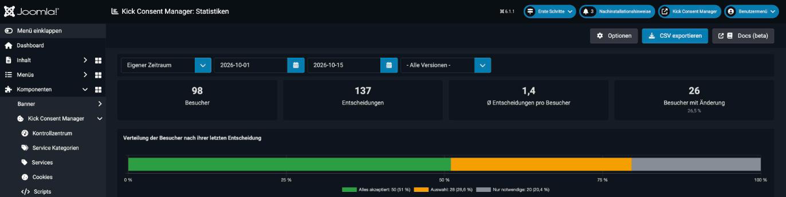

# Statistiken

Der Bereich **Statistiken** zeigt, wie Ihre Besucher mit dem Banner umgehen: Wie viele stimmen allem zu? Wie viele lehnen alles Optionale ab? Welche Services werden wie oft akzeptiert? Und wie entwickelt sich das über die Zeit?



---

## So wird gezählt

Jedes Speichern im Banner legt einen neuen Eintrag im [Einwilligungs-Protokoll](./consents) an. Wer seine Auswahl mehrmals ändert, hat deshalb mehrere Einträge. Die Statistik zählt **Besucher, nicht Einträge**:

> Jeder Besucher (erkennbar an seiner UUID) zählt **einmal**, und zwar mit seiner **letzten Entscheidung im gewählten Zeitraum**.

So verfälschen mehrfach speichernde Besucher die Prozente nicht. Die Zahl der Entscheidungen steht trotzdem daneben, damit Sie sehen, wie oft sich Besucher umentscheiden.

---

## Kennzahlen

| Kennzahl | Bedeutung |
|---|---|
| **Besucher** | Anzahl verschiedener UUIDs im Zeitraum |
| **Entscheidungen** | Anzahl aller gespeicherten Einträge im Zeitraum |
| **Ø Entscheidungen pro Besucher** | Entscheidungen geteilt durch Besucher |
| **Besucher mit Änderung** | Besucher, die im Zeitraum mehr als einmal gespeichert haben (Anzahl und Anteil) |

### Verteilung der Besucher

Die letzte Entscheidung jedes Besuchers wird einer von drei Gruppen zugeordnet. Maßgeblich sind die **optionalen Kategorien**, also alle veröffentlichten Kategorien, die nicht als „Notwendig“ markiert sind:

| Gruppe | Bedeutung |
|---|---|
| **Alles akzeptiert** | Alle optionalen Kategorien wurden akzeptiert |
| **Auswahl** | Mindestens eine, aber nicht alle optionalen Kategorien wurden akzeptiert |
| **Nur notwendige** | Keine optionale Kategorie wurde akzeptiert |

::: tip Auswahl ohne Häkchen
Wer im Preference Center alle optionalen Kategorien abwählt und speichert, landet bei „Nur notwendige“, genau wie bei „Notwendige Cookies akzeptieren“. Früher wurde so eine Auswahl fälschlich als Zustimmung gezählt.
:::

### Zustimmung pro Kategorie und Service

Die beiden Tabellen zeigen, wie viele der Besucher (und wie viel Prozent) eine Kategorie oder einen Service akzeptiert haben. Notwendige Kategorien und Services sind immer aktiv und werden deshalb ohne Rate angezeigt. Es erscheinen nur **veröffentlichte** Kategorien und Services.

### Verlauf pro Tag

Das Liniendiagramm zeigt pro Tag die Zahl der Besucher und der Entscheidungen. Tage ohne Eintrag werden mit 0 aufgefüllt. Die Tage beziehen sich auf **UTC** (so speichert Joomla die Zeitstempel).

---

## Filter



| Filter | Beschreibung |
|---|---|
| **Zeitraum** | Heute, Letzte 7 / 30 / 90 Tage, Letzte 12 Monate, Gesamter Zeitraum oder Eigener Zeitraum. Voreinstellung: Letzte 30 Tage. |
| **Anfangs- und Enddatum** | Nur bei „Eigener Zeitraum“. Die Datumsangaben gelten in Ihrer Zeitzone, das Enddatum einschließlich des ganzen Tages. |
| **Konfigurationsversion** | Wertet nur Entscheidungen einer bestimmten Cookie-Version aus (siehe [Konfigurationsversion](./configuration#konfigurationsversion)). |

Alle Zahlen, Tabellen und das Diagramm richten sich nach den gewählten Filtern.

::: warning Konfigurationsänderungen
Erhöhen Sie die Konfigurationsversion, fragt der Banner alle Besucher erneut. Dieselben Besucher können dann in zwei Versionen auftauchen. Für einen sauberen Vergleich wählen Sie im Filter eine einzelne Konfigurationsversion.
:::

---

## CSV-Export

Der Button **CSV exportieren** in der Werkzeugleiste lädt die Auswertung der aktuell gewählten Filter herunter:

- Zeitraum, Kennzahlen, Verteilung, Kategorien, Services und Tagesverlauf in einer Datei
- UTF-8 mit BOM und Semikolon als Trennzeichen, damit Excel die Datei direkt richtig öffnet
- Zahlen mit Dezimalkomma

---

## Datengrundlage

Die Statistik wertet die Tabelle `#__kickconsentmanager_consents` aus. Pro Eintrag werden die akzeptierten Kategorien und Services aus dem gespeicherten Cookie (`rawdata`) gelesen. Dort steht zum Beispiel:

```json
{
  "uuid": "ad4db06d-31b4-4f38-adc3-b49e9e61c9b4",
  "opt_in": true,
  "serviceCategories": ["essential", "statistics"],
  "services": ["kcm", "google-analytics"],
  "configVersion": 1
}
```

Bei „Notwendige Cookies akzeptieren“ sind `serviceCategories` und `services` leer.

::: info Seit Version 1.5
Frühere Versionen zählten Einträge statt Besucher und kannten nur „Opt-in“ und „Opt-out“. Die Zahlen können sich daher nach dem Update ändern, siehe [Update auf 1.5](./update-1-5).
:::

---

## Hinweise

- Sehr niedrige Zahlen insgesamt können auf technische Probleme mit dem Banner hindeuten, zum Beispiel wenn er auf bestimmten Seiten nicht angezeigt wird.
- Eine niedrige Zustimmung für Marketing-Services ist normal und rechtlich gewollt.
- Stark wachsende Anteile bei „Nur notwendige“ können auf eine unübersichtliche Gestaltung oder mangelndes Vertrauen hindeuten.
- Der Zeitraum „Gesamter Zeitraum“ hängt davon ab, wie lange Sie Einwilligungen aufbewahren. Das [Task-Plugin](./plugins#task-plugin-plg-task-kickconsentmanager) löscht abgelaufene Einträge.
