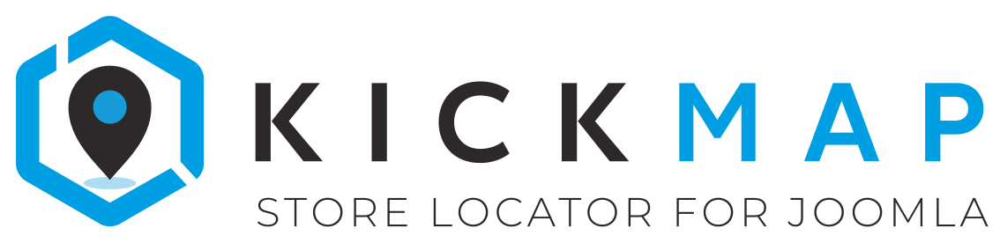
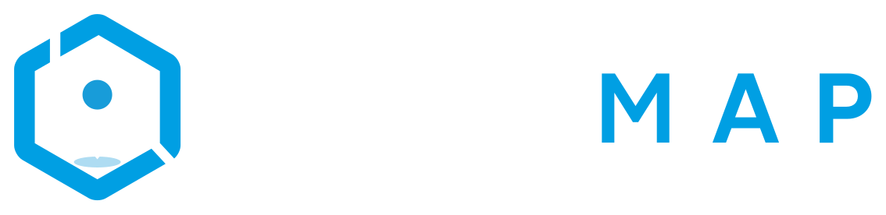

# Logo & Media

## Videos

### KickMap in 60 Seconds

<video class="km-video" controls preload="metadata" poster="../../../components/com_kickmap/assets/kickmap-1-0-16x9-en.jpg">
  <source src="../../../components/com_kickmap/assets/kickmap-1-0-16x9-en.mp4" type="video/mp4">
</video>

Overview: map with OpenStreetMap or Google Maps, filters and radius search, opening hours, CSV import, multilingual support, Joomla standards and YOOtheme Pro.

German version

<video class="km-video" controls preload="none" poster="../../../components/com_kickmap/assets/kickmap-1-0-16x9-de.jpg">
  <source src="../../../components/com_kickmap/assets/kickmap-1-0-16x9-de.mp4" type="video/mp4">
</video>

### KickMap in the Backend

<video class="km-video" controls preload="metadata" poster="../../../components/com_kickmap/assets/kickmap-backend-16x9-en.jpg">
  <source src="../../../components/com_kickmap/assets/kickmap-backend-16x9-en.mp4" type="video/mp4">
</video>

Small everyday tools: address when dropping the marker, map in the location list (hover and double-click) and custom pins per category.

German version

<video class="km-video" controls preload="none" poster="../../../components/com_kickmap/assets/kickmap-backend-16x9-de.jpg">
  <source src="../../../components/com_kickmap/assets/kickmap-backend-16x9-de.mp4" type="video/mp4">
</video>

## Logo

  
  

| Variant | Files |
|---|---|
| Logo with claim | [SVG](../../../components/com_kickmap/assets/kickmap-logo-claim.svg) · [PNG](../../../components/com_kickmap/assets/kickmap-logo-claim.png) |
| Logo with claim, light (for dark backgrounds) | [SVG](../../../components/com_kickmap/assets/kickmap-logo-claim-invers.svg) · [PNG](../../../components/com_kickmap/assets/kickmap-logo-claim-invers.png) |
| Logo with German claim "Standortkarte für Joomla" | [SVG](../../../components/com_kickmap/assets/kickmap-logo-claim-de.svg) |
| Logo without claim | [SVG](../../../components/com_kickmap/assets/kickmap-logo.svg) · [light](../../../components/com_kickmap/assets/kickmap-logo-invers.svg) |
| Signet | [SVG](../../../components/com_kickmap/assets/kickmap-signet.svg) |

The logo follows the Kicktemp design: open Kicktemp hexagon with a location pin, word mark "KICK" in anthracite (`#2d2929`) and "MAP" in Kicktemp blue (`#009fe3`).

## Icon

The icon belongs to the icon family of the Kicktemp extensions (hexagon with gradient, white line pictogram).

[SVG](../../../components/com_kickmap/assets/kickmap-icon.svg) · [PNG 512 × 512](../../../components/com_kickmap/assets/kickmap-icon-512.png)
