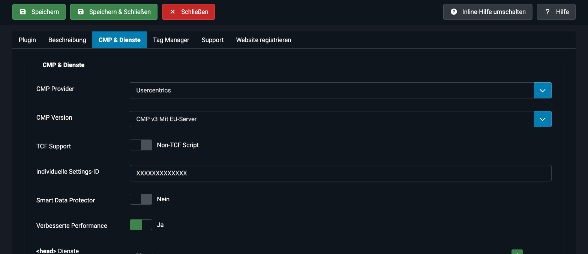
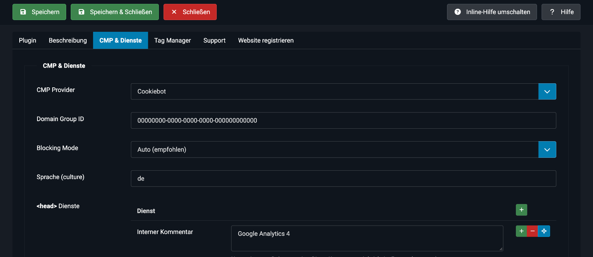
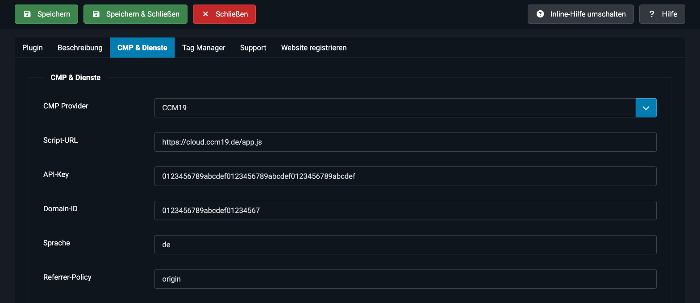

# CMP einrichten

Öffne im Joomla-Backend **System → Plugins**, suche nach **Kick Tracking Assistant** und wechsle auf den Tab **CMP & Dienste**.

Wähle bei **CMP Provider** deinen Anbieter. Mit **Keine CMP laden** wird kein Banner eingebunden. Der Google Tag Manager kann trotzdem geladen werden.

> [!IMPORTANT]
> Binde die CMP nur an einer Stelle ein. Wenn dein Template oder ein anderes Plugin den Banner bereits lädt, erscheint er doppelt.

## Usercentrics

| Feld | Beschreibung |
|---|---|
| **CMP Version** | CMP v3 oder v2, jeweils mit oder ohne EU-Server. CMP v1 ist veraltet. Die passende Version findest du im Usercentrics Admin Interface unter *Implementierung*. |
| **TCF Support** | Lädt das Skript mit Unterstützung für das IAB Transparency & Consent Framework (nur ab CMP v2). |
| **individuelle Settings-ID** | Die Settings-ID deines Usercentrics-Projekts. |
| **Smart Data Protector** | Lädt zusätzlich den Datenschutz-Proxy von Usercentrics, damit Inhalte vor der Zustimmung durch Platzhalter ersetzt werden. |
| **Verbesserte Performance** | Gibt `preconnect`- und `preload`-Hinweise für die Usercentrics-Server aus. |

Sobald die Settings-ID gespeichert ist, zeigt die Auswahl **Consentname** bei deinen Skripten die Dienste aus deinen Usercentrics-Einstellungen an (siehe [Eigene Skripte blockieren](/plugins/plg-system-kicktrackingassistant/skripte)).

## Cookiebot

| Feld | Beschreibung |
|---|---|
| **Domain Group ID** | Die ID deiner Domain-Gruppe (CBID). Du findest sie im Cookiebot-Admin unter *Implementierung*. |
| **Blocking Mode** | **Auto (empfohlen)**: Cookiebot blockiert Skripte und Cookies automatisch bis zur Einwilligung. **Keine automatische Blockierung**: Du steuerst das Blockieren selbst. |
| **Sprache (culture)** | Optional. Erzwingt eine Sprache, zum Beispiel `de`. Ohne Angabe wird die Browsersprache verwendet. |

> [!WARNING]
> Cookiebot zeigt den Banner nur auf Domains, die in deiner Domain-Gruppe hinterlegt sind. Lege die Domain deiner Website im Cookiebot-Admin unter *Domains und Aliase* an. Im kostenlosen Tarif ist nur eine Domain erlaubt.

Beim Blocking Mode **Auto** markiert das Plugin den Consent-Standardwert und den Google Tag Manager mit `data-cookieconsent="ignore"`, damit Cookiebot sie nicht blockiert.

## CCM19

| Feld | Beschreibung |
|---|---|
| **Script-URL** | Standard ist `https://cloud.ccm19.de/app.js`. Bei einer eigenen CCM19-Installation trägst du deine URL ein. |
| **API-Key** | Nur der Key, **ohne** weitere Teile der URL. |
| **Domain-ID** | Die ID deiner Domain in CCM19. Du findest sie im Einbettungs-Snippet im Dashboard. |
| **Sprache** | Optional, zum Beispiel `de`. |
| **Referrer-Policy** | Standard ist `origin`. |

> [!WARNING]
> Kopiere beim API-Key nur den Key selbst. Steht im Feld zusätzlich `&domain=…`, liefert CCM19 den Fehler `invalid apikey, domain, theme or lang` und der Banner erscheint nicht.

Das Einbettungs-Snippet mit allen Werten findest du im CCM19-Dashboard unter *Dashboard & Einbindung*.

## Speichern und prüfen
1. Speichere das Plugin.
2. Rufe deine Website im Frontend auf.
3. Der Banner erscheint beim ersten Besuch. Lösche zum erneuten Testen die Cookies und den lokalen Speicher deiner Domain.
4. Im Quelltext siehst du hinter `<head>` den Consent-Standardwert, den CMP-Loader und den Google Tag Manager.
