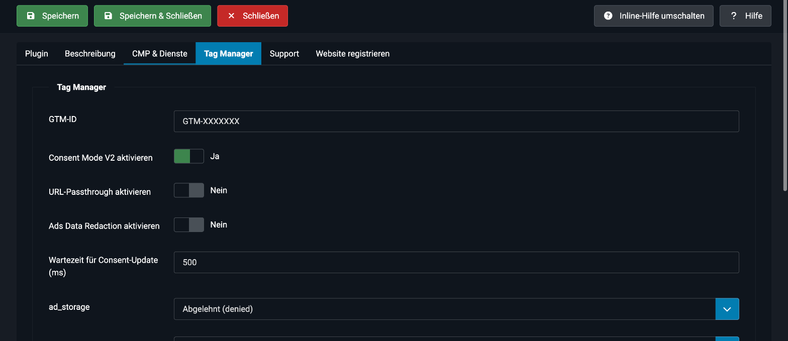

# Google Tag Manager und Consent Mode v2

Die Einstellungen findest du im Plugin **Kick Tracking Assistant** auf dem Tab **Tag Manager**.



## Was ist Consent Mode v2?
Mit dem Google Consent Mode teilst du Google mit, welche Einwilligungen der Besucher erteilt hat. Version 2 enthält zusätzlich die Signale `ad_user_data` und `ad_personalization`.

Der Ablauf besteht aus zwei Schritten:

1. **Standardwert (`default`)**: Wird gesetzt, bevor irgendein Google-Tag lädt. Üblicherweise stehen alle Signale auf `denied`. Das übernimmt das Plugin.
2. **Aktualisierung (`update`)**: Sendet deine CMP, sobald der Besucher eine Auswahl trifft.

## Einstellungen
| Feld | Beschreibung |
|---|---|
| **GTM-ID** | Deine Container-ID, zum Beispiel `GTM-XXXXXXX`. Ohne gültige ID wird nichts ausgegeben. |
| **Consent Mode V2 aktivieren** | Gibt den Standardwert aus. Standard: aktiviert. |
| **GTM `<noscript>` Iframe laden** | Nur wählbar, wenn Consent Mode **deaktiviert** ist. Das Iframe verbindet sich sofort mit Google, auch ohne Einwilligung. |
| **URL-Passthrough aktivieren** | Gibt `gtag('set', 'url_passthrough', true)` aus und verbessert die Zuordnung, wenn Cookies abgelehnt werden. |
| **Ads Data Redaction aktivieren** | Gibt `gtag('set', 'ads_data_redaction', true)` aus. Werbedaten werden vor der Zustimmung anonymisiert. |
| **Wartezeit für Consent-Update (ms)** | `wait_for_update`: So lange wartet der GTM auf das Update der CMP. Standard: 500. Mit 0 wird der Wert nicht ausgegeben. |

### Standardwerte der Signale
Für diese Signale legst du den Standardwert fest:

- `ad_storage`
- `analytics_storage`
- `ad_user_data`
- `ad_personalization`

Du kannst jeweils **Erlaubt (granted)**, **Abgelehnt (denied)** oder **Keine Ausgabe** wählen. Bei **Keine Ausgabe** wird das Signal nicht im Standardwert gesetzt.

### Benutzerdefinierte Consent-Werte
Hier ergänzt du weitere Signale, zum Beispiel `functionality_storage`, `personalization_storage` oder `security_storage`.

- Erlaubt sind Kleinbuchstaben und Unterstriche im Namen.
- Als Wert sind `granted`, `denied` oder keine Ausgabe möglich.
- Ungültige Namen werden verworfen.

## Beispiel für die Ausgabe
```html
<script>window.dataLayer = window.dataLayer || [];
function gtag(){dataLayer.push(arguments);}
gtag('consent', 'default', {"ad_storage":"denied","analytics_storage":"denied","ad_user_data":"denied","ad_personalization":"denied","wait_for_update":500});</script>
<script src="…"></script> <!-- CMP-Loader -->
<!-- Google Tag Manager -->
<script>(function(w,d,s,l,i){…})(window,document,'script','dataLayer','GTM-XXXXXXX');</script>
```

## Das Update kommt von der CMP
Das Plugin setzt den Standardwert. Das `consent update` sendet deine CMP. In unseren Tests passiert das so:

| CMP | Verhalten nach „Alle akzeptieren“ |
|---|---|
| **Cookiebot** | Sendet `consent update` mit allen Signalen und zusätzlich `cookie_consent_*`-Events. |
| **CCM19** | Sendet `consent update` für die vier Signale. |
| **Usercentrics** | Sendet `consent update` abhängig von deiner Konfiguration. Prüfe im Usercentrics Admin, dass deine Dienste den Google-Signalen zugeordnet sind. Sonst bleiben zum Beispiel die Werbe-Signale auf `denied`. |

> [!TIP]
> Prüfe den Ablauf mit dem **Tag Assistant** oder dem **GTM-Vorschau-Modus**. Im Consent-Tab siehst du Standardwert und Aktualisierung. Achte darauf, dass deine Tags im Container eine passende Einwilligungsprüfung haben.

## Häufige Fehler
- **GTM doppelt eingebunden:** Entferne den GTM aus dem Template oder anderen Plugins, wenn du ihn hier eintragen lässt.
- **Standardwert kommt zu spät:** Das passiert, wenn ein anderes Plugin den GTM vor diesem Plugin lädt. Deaktiviere dort den GTM.
