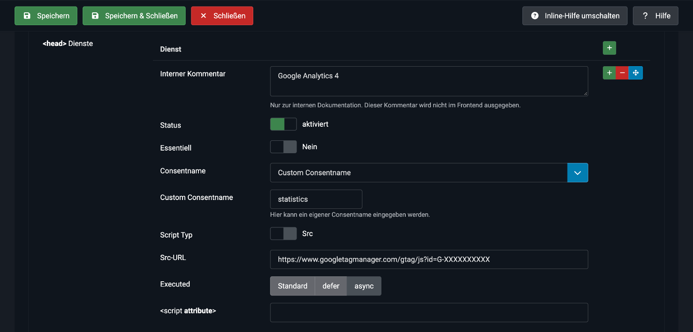

# Eigene Skripte blockieren

Im Tab **CMP & Dienste** verwaltest du eigene Skripte in zwei Listen:

- **`<head>` Dienste**: werden vor `</head>` ausgegeben
- **`</body>` Dienste**: werden vor dem letzten `</body>` ausgegeben

Jede Zeile ist ein Dienst, zum Beispiel Google Analytics, ein Pixel oder ein Chat-Widget.

## Felder eines Dienstes

| Feld | Beschreibung |
|---|---|
| **Interner Kommentar** | Nur zur Dokumentation. Wird nicht im Frontend ausgegeben. |
| **Status** | Aktiviert oder deaktiviert. Deaktivierte Dienste werden nicht ausgegeben. |
| **Essentiell** | Wenn **Ja**, läuft das Skript sofort und ohne Einwilligung. Verwende das nur für technisch notwendige Skripte. |
| **Consentname** | Der Dienst bzw. die Kategorie, an die die Einwilligung gebunden ist. |
| **Custom Consentname** | Eigener Name, wenn du **Custom Consentname** gewählt hast. |
| **Script Typ** | **Src** (Skript-URL) oder **Code** (Inline-JavaScript). |
| **Src-URL / JavaScript Code** | Je nach Script Typ. |
| **Executed** | Standard, `defer` oder `async` (nur bei Src). |
| **Script Attribute** | Zusätzliche Attribute, zum Beispiel `data-foo="1"`. Werte mit `<` oder `>` werden verworfen. |

> [!IMPORTANT]
> Ein **nicht essentielles** Skript **ohne** Consentname wird nicht ausgegeben, weil die CMP es nie freigeben könnte.

## Consentname je CMP
Welche Werte du bei **Consentname** wählen kannst, hängt vom Anbieter ab:

| CMP | Auswahl | Ausgegebenes HTML |
|---|---|---|
| **Usercentrics** | Dienste aus deinen Usercentrics-Einstellungen (nach Speichern der Settings-ID), zum Beispiel *Google Analytics 4* | `<script type="text/plain" data-usercentrics="Google Analytics 4">` |
| **Cookiebot** | Kategorien **Präferenzen**, **Statistiken**, **Marketing** (`preferences`, `statistics`, `marketing`) | `<script type="text/plain" data-cookieconsent="statistics">` |
| **CCM19** | Nur **Custom Consentname**: der Name der Script-Loader-Gruppe | `<script type="text/x-ccm-loader" data-ccm-loader-group="meine-gruppe">` (bei Src zusätzlich `data-ccm-loader-src`) |

Die Skripte bleiben bis zur Einwilligung inaktiv und werden danach von der CMP freigegeben.

### CCM19: Script-Loader-Gruppe anlegen
CCM19 gibt blockierte Skripte nur frei, wenn der Gruppenname zu einer Einbindung passt:

1. Öffne in CCM19 **Einbindungen & Cookies** und bearbeite die passende Einbindung (zum Beispiel *Google Analytics 4*).
2. Trage im Feld **Gruppe für den Script-Loader** einen Namen ein, zum Beispiel `ga4`.
3. Speichere.
4. Wähle im Plugin bei **Consentname** den Eintrag **Custom Consentname** und trage denselben Namen (`ga4`) ein.

## Beispiel
Google Analytics 4 über Cookiebot, nur nach Einwilligung in Statistiken:

- **Essentiell:** Nein
- **Consentname:** Statistiken
- **Script Typ:** Src
- **Src-URL:** `https://www.googletagmanager.com/gtag/js?id=G-XXXXXXXXXX`
- **Executed:** async

> [!TIP]
> Wenn du Analytics ohnehin über den Google Tag Manager ausspielst, brauchst du hier kein eigenes Skript. Steuere die Einwilligung dann im GTM über Consent Mode.

## So prüfst du es
1. Öffne die Seite im privaten Fenster und den Quelltext.
2. Das Skript steht als `text/plain` (Usercentrics, Cookiebot) bzw. `text/x-ccm-loader` (CCM19) im HTML.
3. Prüfe in der Browser-Konsole, dass es vor der Einwilligung **nicht** läuft.
4. Akzeptiere im Banner. Danach läuft das Skript.
