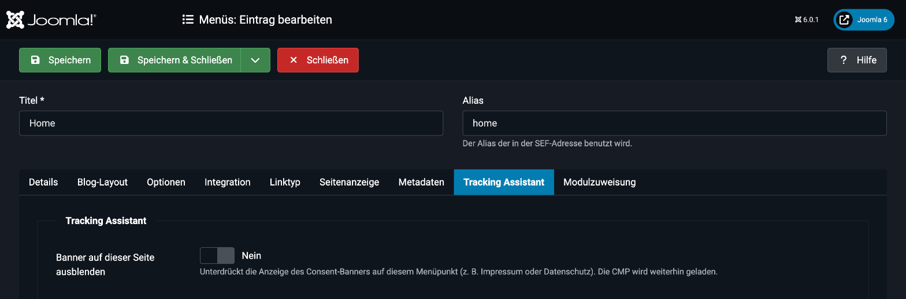

# Weitere Funktionen

## Cookie-Erklärung einfügen
Mit dem Platzhalter `{KickCookieDeclaration}` bindest du die Cookie-Erklärung deiner CMP in einen Beitrag oder ein Modul ein, zum Beispiel auf deiner Datenschutzseite.

Schreibe dazu den Platzhalter an die gewünschte Stelle:

```
{KickCookieDeclaration}
```

Das Plugin ersetzt ihn abhängig vom Anbieter:

| CMP | Ausgabe |
|---|---|
| **Cookiebot** | Das Cookiebot-Skript `cd.js` mit deiner Domain Group ID (Cookie-Erklärung). |
| **Usercentrics** | Ein Embed-Container `<div class="uc-embed" uc-data="all" uc-styling="true"></div>`. |
| **CCM19** | Kein Platzhalter. Verwende die Cookie-Erklärungs-Tabelle direkt aus CCM19 (*Cookie-Erklärungs-Tabelle* im CCM19-Dashboard). Der Platzhalter bleibt leer. |

> [!NOTE]
> Der Platzhalter funktioniert in allen Inhalten, die über Joomla ausgegeben werden. In Editoren, die den Text umformatieren, solltest du ihn als reinen Text ohne Auszeichnung einfügen.

## Banner auf einzelnen Seiten ausblenden
Bei Menüpunkten, zum Beispiel Impressum oder Datenschutzerklärung, möchtest du den Banner oft nicht anzeigen, damit Besucher den Text lesen können.



1. Öffne den Menüpunkt unter **Menüs**.
2. Wechsle auf den Tab **Tracking Assistant**.
3. Aktiviere **Banner auf dieser Seite ausblenden**.
4. Speichere.

Die CMP wird weiterhin geladen, nur die Anzeige wird unterdrückt.

| CMP | Verhalten |
|---|---|
| **Usercentrics** | Setzt `UC_UI_SUPPRESS_CMP_DISPLAY` (bei CMP v1 wird der Banner per CSS ausgeblendet). |
| **Cookiebot** | Blendet den Dialog `#CybotCookiebotDialog` per CSS aus. |
| **CCM19** | Nicht verfügbar. |

> [!WARNING]
> Prüfe die rechtlichen Anforderungen für deine Seite. Besucher müssen den Banner an anderer Stelle erreichen und ihre Einwilligung ändern können.

## Fehlerseiten
Auf Fehlerseiten (zum Beispiel 404) löst Joomla das Standard-Ereignis `onAfterRender` nicht aus. Das Plugin verarbeitet diese Seiten deshalb separat. Consent-Standardwert, CMP, Google Tag Manager und deine Skripte werden dort genauso ausgegeben wie auf normalen Seiten, unabhängig vom Template.

## Website registrieren (Updates)
Damit deine Website Updates erhält, muss sie für den Update-Server registriert sein:

1. Öffne [kicktemp.shop/dashboard/websites](https://kicktemp.shop/dashboard/websites) und kopiere deinen Token.
2. Wechsle im Plugin auf den Tab **Website registrieren**.
3. Füge den Token ein und klicke auf **Jetzt registrieren**.

Die Registrierung ist nur im Backend und nur für Benutzer mit der Berechtigung `core.admin` möglich.
